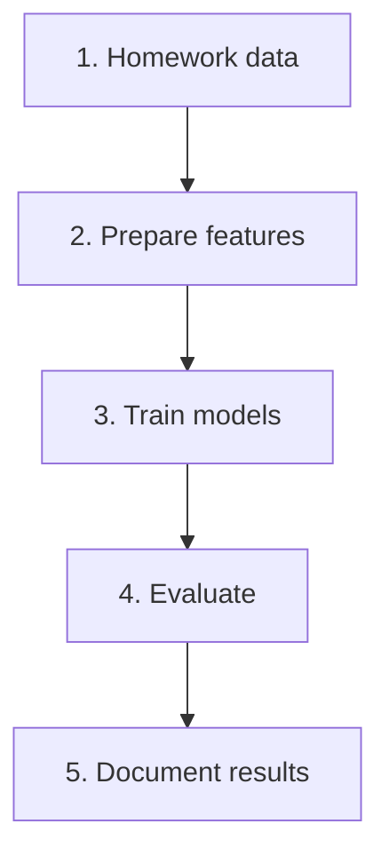

<div align="center">

# DTC ML Homework

**Machine Learning Zoomcamp practice**

Structured homework notebooks from the DataTalks.Club Machine Learning Zoomcamp.

[](https://www.python.org/)
[](https://jupyter.org/)
[](https://mounir-gmamsi.netlify.app/)

</div>

---

## Overview

This repository collects homework work from the DataTalks.Club Machine Learning Zoomcamp. It documents practical exercises in data preparation, modelling and evaluation using Python notebooks.

---

## What the product delivers

| Capability | Description |
|------------|-------------|
| Guided practice | Zoomcamp homework exercises in notebook form |
| Data preparation | Cleaning and feature work for ML tasks |
| Modelling | Apply classical ML workflows |
| Evaluation | Measure and interpret model quality |
| Reproducibility | Clear notebook structure for review |

---

## Technology stack


| Layer | Technologies |
|-------|----------------|
| Environment | Jupyter Notebook |
| Data | Python, Pandas, NumPy |
| Modelling | scikit-learn |
| Versioning | Git |

---

## Solution flow

| Step | Stage | Technologies |
|:----:|-------|--------------|
| 1 | Load homework dataset | Pandas |
| 2 | Explore and prepare features | Python, NumPy |
| 3 | Train baseline / assigned models | scikit-learn |
| 4 | Evaluate results | Notebook metrics |
| 5 | Document conclusions | Jupyter markdown |



---

## Repository structure

| File | Purpose |
|------|---------|
| `HW_03.ipynb` | Homework notebook |
| `README.md` | Project overview |

---

## Run locally

```bash
python -m venv .venv
.venv\Scripts\activate
pip install jupyter pandas numpy scikit-learn
jupyter notebook HW_03.ipynb
```

---

## Author

**Mounir Gmamsi**  
[Portfolio](https://mounir-gmamsi.netlify.app/) · [GitHub](https://github.com/Mr-Gms-33) · [LinkedIn](https://www.linkedin.com/in/mounir-gmamsi-1595951b3)
